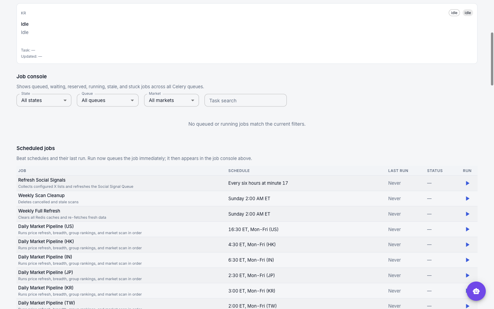

# Operations Guide

Running the server-backed app: the stack and its market workers, first-run bootstrap and reset, the data source mode, the Operations page and scheduled jobs, Options analytics, the balanced Market RS rollout, static-site publishing, market calendars, and common recovery paths.

## Runtime Model

The live app stores runtime choices in PostgreSQL and runs market work through Redis/Celery queues.

- `runtime.primary_market` controls the market opened first and used for startup defaults.
- `runtime.enabled_markets` controls which markets the app should hydrate and expose.
- `runtime.bootstrap_state` moves from `not_started` to `running` to `ready`.
- Runtime activity rows report per-market lifecycle, stage, progress, owner task, and warning/failure state.

The UI surfaces this through the header status chip and `/operations`.

## Starting the Stack

All start/stop goes through `scripts/docker-compose-enabled-markets.sh` — a thin wrapper around `docker compose` that derives the right Compose **profiles** from `ENABLED_MARKETS` and forwards every other argument unchanged.

**Prerequisites:** Docker (with Compose v2), Python 3.11+ on `PATH` (the wrapper uses it to compute profiles), and a `.env` (or `.env.docker`) holding at least `SERVER_AUTH_PASSWORD` and `ENABLED_MARKETS`.

```bash
# Start (detached), enabling US + four Asian markets
ENABLED_MARKETS=US,HK,JP,TW,KR scripts/docker-compose-enabled-markets.sh up -d

# Foreground (watch logs); Ctrl-C stops
ENABLED_MARKETS=US,HK,JP,TW,KR scripts/docker-compose-enabled-markets.sh up

# Stop and remove containers
ENABLED_MARKETS=US,HK,JP,TW,KR scripts/docker-compose-enabled-markets.sh down
```

Open the app at the deployment URL and sign in with `SERVER_AUTH_PASSWORD`. The wrapper prints the resolved `ENABLED_MARKETS` and `COMPOSE_PROFILES` before running.

### Options

| Capability | How |
|------------|-----|
| Select market workers | `ENABLED_MARKETS=US,HK,JP,TW,KR` as an env var, or set it in `.env` / `.env.docker`. Default: `US`. |
| Any Compose subcommand | Forwarded verbatim: `up`, `up -d`, `down`, `pull`, `ps`, `logs -f`, `restart <service>`. |
| Compose overlays | Append `-f docker-compose.yml -f docker-compose.prod.yml …` for prod/HTTPS/release layers. |
| Env file | Auto-uses `.env`, then `.env.docker`; override with `--env-file <path>`. |
| Extra profiles | `COMPOSE_PROFILES=…` is merged with the derived market profiles. |
| Python interpreter | Pin with `STOCKSCREEN_PYTHON=/path/to/python3.11+` if the default isn't 3.11+. |

### Selecting enabled markets

The base Compose file defines workers for every supported market, but market-specific workers sit behind Compose profiles. The wrapper starts only the profiles required by `ENABLED_MARKETS`.

For `ENABLED_MARKETS=US,HK,JP,TW,KR`, Docker starts the US/HK/JP/TW/KR market-job and user-scan workers; CN/IN/DE/CA/SG/MY/AU containers are not created, and the global data-fetch worker listens only to those markets' `data_fetch_*` queues.

Keep the first-run wizard's enabled markets within the deployment `ENABLED_MARKETS` set. To add a market later, update `ENABLED_MARKETS` and recreate:

```bash
ENABLED_MARKETS=US,HK,JP,TW,KR,CN scripts/docker-compose-enabled-markets.sh up -d
```

> **Note:** `down` always tears down **all** market profiles (not just the enabled ones) and auto-adds `--remove-orphans`, so it fully stops the stack regardless of the `ENABLED_MARKETS` value on that line.

## First-Run Bootstrap

On a fresh (empty) database the app opens to the first-run wizard. Choose a primary market and any secondary markets to hydrate in the background. The workspace opens when the primary market is ready; secondary markets continue on their own queues.

| | |
|---|---|
|  |  |
| *Primary-market picker* | *Staged hydration progress* |

Bootstrap stages:

1. **Universe refresh** — seeds the market symbol list. US uses S&P 500 / Russell / NDX via `refresh_stock_universe`; HK / IN / JP / KR / TW / CN / CA / DE / SG / MY / AU use official exchange feeds via `refresh_official_market_universe`.
2. **Benchmark + price refresh** — imports the GitHub daily price bundle first, accepts recent stale bundles during bootstrap, then live-fetches missing/current-session gaps (`7d` top-up for stale symbols, `2y` for no-history symbols). Under `live_only` this stage skips the bundle and fetches live — see [Market Data Source Mode](#market-data-source-mode).
3. **Fundamentals refresh** — loads quarterly and annual financials.
4. **Market RS publication** — on a pristine installation, backfills balanced-horizon RS, validates a staged static export, and activates it atomically. Any other database stays in shadow mode until an operator activates it ([Balanced Market RS Rollout](#balanced-market-rs-rollout)).
5. **Breadth calculation** — computes StockBee-style advance/decline data with gap-fill.
6. **Market exposure** — derives the market-regime exposure state from the refreshed breadth data.
7. **Group rankings** — averages canonical constituent RS values for each group, using the active formula for that market.
8. **Feature snapshot** — daily Setup Engine feature rollup for each enabled Market, using that Market's universe and publication pointer.
9. **Group history** — after activation, seeds formula-compatible history used by 1W/1M/3M/6M rank changes, movers, and RRG.
10. **Initial autoscan** — publishes the first default-profile scan.

Selecting many enabled markets multiplies this work. On smaller hosts, start with one primary market and add markets after the workspace is ready.

## Market Data Source Mode

`MARKET_DATA_SOURCE_MODE` sets where market data comes from. Every app and worker container reads it once at startup; there is no runtime toggle. Valid values are `github_first` (the default) and `live_only` (not `live`).

`github_first` tries the project's GitHub release bundles first, during bootstrap and on the weekly schedule. `live_only` skips them and fetches from live providers (yfinance / Finviz):

| Data | `github_first` | `live_only` |
|------|----------------|-------------|
| Daily prices | Per-market 2-year OHLCV bundle (release `daily-price-data`), imported when its manifest is fresh (within ~4 days) and the checksum matches; live top-ups then fill stale and no-history symbols | Live |
| Weekly universe | GitHub weekly-reference bundle: no-op when current, live sources when missing or stale | Live |
| Weekly fundamentals | GitHub weekly-reference bundle, then the live provider | Live |
| Weekly IBD classification | GitHub `ibd-classification-data` bundle (Sunday, after the weekly classifier publishes). No-op when already `up_to_date`; a GitHub miss **fails the sync and raises an alert**, keeping the prior classifications | **No-op: classifications stop updating.** There is no live source, and non-US markets without a curated CSV get IBD coverage only from this bundle |

For prices, universe and fundamentals, a GitHub miss (missing or stale manifest, checksum mismatch, network error) silently falls back to live, so `github_first` is safe to leave on. It is faster and hits provider rate limits less, because history downloads as one bundle instead of symbol by symbol. It is also why some Celery jobs still reach GitHub after bootstrap; that is expected ([issue #266](https://github.com/xang1234/stock-screener/issues/266)).

**Changing it on a running app.** Set it in the env file you pass with `--env-file`: `.env` for the base stack, `.env.docker` for the prod overlay (the README / INSTALL_DOCKER prod commands already pass `--env-file .env.docker`). Compose interpolates it from there into the shared `x-app-env` entry, which outranks the prod overlay's own `env_file`, so setting it only in `.env.docker` without `--env-file` has no effect. Then stop and start the stack; recreating the containers alone is not enough:

```bash
# MARKET_DATA_SOURCE_MODE=live_only (or github_first) in the --env-file file, then:
ENABLED_MARKETS=US,HK,JP,TW,KR scripts/docker-compose-enabled-markets.sh down
ENABLED_MARKETS=US,HK,JP,TW,KR scripts/docker-compose-enabled-markets.sh up -d
```

No cache flush is needed: the mode changes how data is fetched, not data already stored. Switching to `live_only` keeps existing data (IBD classifications stop refreshing); switching back to `github_first` resumes bundle syncing on the next refresh.

## Reset to a Clean Bootstrap

To re-run the first-run wizard from scratch (e.g. corrupt state, schema reset, or a clean demo), stop the stack, clear DB/cache/scheduler state, and start again. The Postgres directory is **moved, not deleted**, so the reset is reversible.

```bash
# 1. Stop the stack
ENABLED_MARKETS=US,HK,JP,TW,KR scripts/docker-compose-enabled-markets.sh down

# 2. Preserve the current DB → forces an empty one (this is what re-triggers bootstrap)
mv docker-data/postgres docker-data/postgres.saved.$(date +%Y%m%d_%H%M%S)

# 3. Drop the Redis volume (Celery broker + results + app cache)
docker volume rm $(docker volume ls -q | grep '_redis_data$')

# 4. Reset the Celery Beat schedule
rm -f data/celerybeat-schedule

# 5. Start again — the app opens to the first-run wizard
ENABLED_MARKETS=US,HK,JP,TW,KR scripts/docker-compose-enabled-markets.sh up
```

| Step | Effect |
|------|--------|
| `down` | Stops all containers (and orphans). |
| `mv docker-data/postgres …saved.<timestamp>` | Empties the live DB while keeping a timestamped backup (e.g. `postgres.saved.20260624_110650`). |
| `docker volume rm …_redis_data` | Clears the Celery broker/results and the application cache. |
| `rm -f data/celerybeat-schedule` | Forces the scheduler to rebuild its run state. |
| `up` | Boots into first-run bootstrap; watch progress on `/operations`. |

> **Warning:** steps 2–4 wipe the live database, cache, and scheduler state, and step 5 re-hydrates **every** enabled market — heavy on large `ENABLED_MARKETS` sets. The data loss is recoverable only from the moved Postgres directory (and any external backups).

**Roll back** to the pre-reset database:

```bash
ENABLED_MARKETS=US,HK,JP,TW,KR scripts/docker-compose-enabled-markets.sh down
rm -rf docker-data/postgres                                   # discard the fresh bootstrap DB
mv docker-data/postgres.saved.<timestamp> docker-data/postgres
ENABLED_MARKETS=US,HK,JP,TW,KR scripts/docker-compose-enabled-markets.sh up -d
```

## Runtime Activity

The header chip summarizes runtime state:

- **OK** — all markets are idle or ready.
- **Sync / percent** — bootstrap is running.
- **count** — one or more markets have active work.
- **Warn** — a market is stale, stuck, failed, or runtime activity cannot be checked.

Click the chip to open `/operations`.

## Operations Page


*Operations — per-market activity (states, messages, timestamps) above the filterable job console*

| Section | Shows |
|---|---|
| Market activity | Each market's lifecycle, stage, message, progress, and last update |
| Telemetry alerts | Warning and critical alerts, with Acknowledge |
| Market health | Freshness lag, benchmark age, universe drift, completeness |
| Job console | Jobs across Celery queues by state; filter by state, queue, market, or task |
| Lease status | External-fetch and per-market workload leases, and each market's pipeline chain claim |
| Queues / Workers | Queue depth and worker status |

If the jobs request fails, the job console, Lease status, Queues and Workers say so. If a refresh fails after a success, they keep the last data and show when it was fetched.

### Cancelling a job

Every action asks for confirmation first:

| Action | Effect |
|---|---|
| **Cancel** | Removes a queued job; it never runs |
| **Revoke** | A worker that already took the job drops it |
| **Cancel scan** | Marks the scan cancelled; the worker stops at its next checkpoint |
| **Force cancel** / **Force release** | Releases locks while the worker may still be running. Use only when the worker is dead. |

- If the job changed state after the page loaded, the cancel is refused ("Job moved to …, refresh and retry") and nothing changes.
- After an accepted cancel, the row reads **Cancel requested** until the job leaves the console.
- Cancelling a queued Daily Market Pipeline stage ends the chain and releases its claim.

### Releasing a pipeline chain claim

Lease status → Pipeline Chain Claims lists each market's claim. **Release** it only when that market's pipeline stages are gone from the job console, for example after a worker was killed mid-stage, which leaves the claim held for up to 24 hours. Otherwise the next Run starts a second pipeline. Release frees only the claim shown, and is recorded with the other job actions.

## Scheduled Jobs


*Operations — job console, then Scheduled jobs with schedule, last run, status, and run-now*

Shown below the job console when the tasks feature is enabled (one card per job on phones). Status comes from the server's run history, so Beat runs appear as well as manual ones. Jobs that Beat runs per market (Daily Market Pipeline, Weekly Universe, Full and Fundamental Refresh) have one row per market.

### Status

| Status | Meaning |
|---|---|
| **Completed** | Finished |
| **Failed** | Shows the error, including from a task that caught its own error and returned it |
| **Skipped** | Ran but did nothing; shows why (e.g. not a trading day, pipeline already in progress) |
| **Handed off** | Only queued other tasks. The Daily Market Pipeline hands off its stage chain; follow it in Market activity and the job console. |
| **Queued** / **Running** | In progress |
| **Not picked up** | Queued for over 10 minutes: no worker on its queue, or a lost message |
| **Unknown** | No outcome within about 25 hours (Celery's 24-hour hard limit plus a margin). Not counted as a failure. |

### When Run is unavailable

Run is disabled, with the reason on the row, when:

- **The run is queued or running.**
- **Not picked up.** The message may still run once a worker comes up, so a second Run could run the job twice. Cancel it in the job console. A Social Signals refresh waits on `social_ingestion`, which the console doesn't read: start the social worker instead.
- **Unknown, and the run never started**, while its message is still in the broker (queued, or held by a stopped worker), or when the broker can't be searched within 2 seconds. An Unknown run that started and then lost its worker can be run again.
- **Daily Market Pipeline only:** it's not a trading day in that market, or the market's pipeline is in progress. The row links to the claim in Lease status. The server refuses such a Run with 409 before queueing. If those two checks can't be read, the Run is queued anyway and the task's own checks decide, so it can still end up Skipped.

### Daily Market Pipeline chain

Stages: price refresh → Market RS → group rankings → daily snapshot → Options Analytics (US only) → breadth and exposure (markets with breadth).

- The dispatch holds a per-market claim until the last stage finishes or a stage fails. While it is held, a manual Run is refused with 409 and nothing is queued, and a Beat run reads Skipped. A manual Run can still read Skipped if the pre-flight could not read the claim, or the claim was taken between the pre-flight and the dispatch.
- Every 5 minutes a heartbeat checks each claimed chain (#605). It keeps the claim while a stage is queued, held by a worker, running or waiting to retry, so a chain waiting hours behind the single data-fetch worker keeps it.
- The heartbeat releases the claim once a stage fails or is revoked, the chain finishes, or two checks at least 2.5 minutes apart find no trace of the chain (for example, a queued stage was purged). The next Run then dispatches.
- A stage that was waiting to retry, or running when its worker was killed (out of memory, a forced restart), keeps that state until its result expires 24 hours later, so its claim stays that long unless you release it.
- If the heartbeat stops running, a claim expires 48 hours after its last renewal, and a chain still going after that can be overlapped.

### Weekly maintenance

- **Weekly Cache & Telemetry Cleanup** (Sunday 6:00 AM ET) deletes telemetry past retention and the cached prices of delisted symbols.
  - Symbols the universe never held, such as SPY or COT instruments, keep their cache.
  - A market with no active universe rows is skipped.
  - A Redis error fails the run.
- **Weekly Full Refresh (all markets)** is manual only. It re-fetches every market and runs the same cleanup.
- The cache panel's all-markets fundamentals refresh is not a scheduled job and isn't listed.

## Options Command Center Operations

Options analytics are US-only and off by default; enable them with `OPTIONS_ANALYTICS_ENABLED=true`. When disabled, no Yahoo option-chain work is scheduled and Options navigation is hidden.

**Scheduling.** The job runs after a successfully published daily US Feature snapshot, on the existing `data_fetch_us` queue, so the normal US data-fetch worker must be running. It adds no worker or queue family, and cannot fail the already-published equity pipeline.

**Cohort and request budget.**

- The cohort is the top 40 scan Candidates plus the top 40 Leaders, ranked independently, after requiring daily USD volume strictly above $100 million. A symbol in both keeps both source ranks.
- Up to 20 recently dropped symbols stay in collection for five US sessions; only current symbols appear in the Command Center.
- A full 100-symbol cohort costs 201 Yahoo operations: one `^IRX` history request, plus one expiration-list and one selected-chain request per symbol. With three attempts per symbol, the hard ceiling is 601. Fetch concurrency is capped at two and uses the shared yfinance limiter.

**Monitoring and canary.** In Operations, watch **Daily US Options Analytics** and the **Options Analytics** runtime stage; its final message reports expected, completed, core-valid, failed, retried and coverage counts. Start a manual canary from Scheduled jobs or the Command Center's Refresh action, first with a source Feature run whose current cohort has at most three symbols. Before trying the full cohort, check:

- the selected monthly expiration (14–45 DTE) and observation timestamp;
- request and retry counts, coverage, and unavailable reasons;
- the recorded `^IRX` risk-free and dividend assumptions.

**Publication.** Publication is atomic and needs core-valid chains for at least 90% of current symbols. Otherwise the run is kept for diagnostics, the published pointer doesn't move, and readers keep the prior run. A static build likewise keeps fresh equity output, and may copy the last compatible options bundle, marked `stale_relative_to_equity` in its manifest, command-center payload and symbol payloads.

**Retention.**

- Aggregate published observations are kept for about 252 US sessions; strike detail for the latest 30 published runs.
- The Pages workflow carries aggregate history in the versioned `options-history-us-v1.json.gz` release asset. A ticker that drops out and later returns keeps its compatible lifetime history; missing sessions stay gaps and counters don't reset.
- Raw contracts and strike points are not in that asset.

**Rollback.** Set `OPTIONS_ANALYTICS_ENABLED=false` and recreate the API and workers. Collection stops and live navigation disappears; stored runs and history are kept. Static navigation disappears once the root manifest no longer advertises `pages.options`; an already-published static bundle stays as an auditable artifact.

**Data caveats.** Yahoo is an unofficial, best-effort source:

- Chains may omit Greeks, open interest, volume, quotes or expirations, and can be delayed or throttled. The UI shows explicit unavailable reasons rather than invented values.
- Net GEX, gamma flip, call wall and put wall are labeled **Estimated**: they are model outputs, not observed dealer positions.
- Activity metrics are descriptive. Don't read them as premium inflow, buying or selling, or a directional signal.

## Balanced Market RS Rollout

`balanced-horizon-percentile-v2` is activated independently for each Market. Its five same-set excess-return percentiles are weighted **1M 20%**, **3M 30%**, **6M 20%**, **9M 15%**, and **12M 15%** before the composite is re-ranked. Keep the prior `legacy-linear-v1` Market formula pointer and legacy Feature-run ID until the rollout is accepted.

### Fresh database activation

Bootstrap decides once, before dispatch, whether the database is **pristine**, and records the decision in the bootstrap manifest.

- **Pristine** means only formula pointers and application settings exist. Any universe, price, fundamental, breadth, exposure, scan, Feature run, Group rank or Market RS row makes the database non-pristine.
- **One exception:** startup Group-history reconciliation may import raw seed rows before bootstrap starts, provided it first records a valid `runtime.bootstrap.pre_bootstrap_seed_import` marker while the database is still pristine. The first dispatch can then still use fresh activation, as long as no bootstrap output rows exist. A failed reconciliation dispatch clears the marker it created.
- **The fresh marker** survives an interrupted initial bootstrap, and is consumed once every enabled Market has activated balanced RS. A later repair bootstrap or explicit rollback therefore can't silently re-activate balanced RS.
- **Duplicate starts:** each bootstrap dispatch owns a persisted generation for 24 hours, renewed while its market workflows are published, and duplicate starts are rejected by that generation (not by the display-only bootstrap preference). If the API dies mid-dispatch or callbacks are lost, start bootstrap again once the generation has expired; no database edit is needed. Lease expiry alone doesn't invalidate callbacks: the still-current generation may finish until a replacement claims ownership, and callbacks from a superseded generation are ignored.

On a pristine installation, balanced Market RS backfill and guarded activation is a required stage for every enabled Market:

- **Window:** it materializes sessions from 187 calendar days before the latest completed session through that session. That covers the 6M Group-rank lookup plus tolerance, exceeds the 12-week RRG minimum, and includes the current daily Feature snapshot used by the latest scan. It does not calculate every historical session.
- **Requirements:** backfill, balanced Feature publication, staged static parity validation and the two-pointer transaction must all succeed. The primary Market isn't marked ready unless its formula pointer is `balanced-horizon-percentile-v2`.
- **Failure:** both active pointers stay unchanged and that bootstrap chain fails. Correct the reported input or coverage problem and resume bootstrap.
- **Group history** runs after activation, so 1W/1M/3M/6M rank changes, movers and RRG snapshots use the balanced formula. Where point-in-time membership is unavailable, bootstrap may use the current active universe for past dates; that avoids an empty 12-week window, at the cost of survivor bias.

After bootstrap reports ready, verify the pointer and populated Group components:

```sql
SELECT market, formula_version
FROM market_rs_formula_pointers
WHERE market = 'US';

SELECT rs_formula_version,
       MAX(date) AS latest_date,
       COUNT(*) FILTER (WHERE avg_rs_rating_1m IS NOT NULL) AS rows_with_1m,
       COUNT(*) FILTER (WHERE avg_rs_rating_3m IS NOT NULL) AS rows_with_3m
FROM ibd_group_ranks
WHERE market = 'US'
GROUP BY rs_formula_version;
```

A non-pristine database is never auto-activated, even one holding only inactive or historical rows and no startup seed marker. Use the shadow backfill and activation procedure below; it keeps existing data and pointers until every guard passes.

### Existing database rollout

#### 1. Record the rollback state

Before activation, record both active pointers. Substitute the target Market in both predicates:

```sql
SELECT market, formula_version
FROM market_rs_formula_pointers
WHERE market = 'US';

SELECT p.key, p.run_id, r.status, r.as_of_date, r.config_json
FROM feature_run_pointers AS p
JOIN feature_runs AS r ON r.id = p.run_id
WHERE p.key = 'latest_published_market:US';
```

The saved Feature run must remain present with status `published`; activation does not delete it.

#### 2. Run the resumable shadow backfill

Run from `backend` with its virtual environment active. `--start-date` is optional when resuming a repaired range:

```bash
python -m app.scripts.backfill_market_rs \
  --market US \
  --through-date 2026-07-17
```

This leaves the active pointers unchanged. Inspect the JSON report: `formula_version` must be `balanced-horizon-percentile-v2`, `failed_count` and `validation_errors` must be empty/zero, every required trading date must be completed, and the latest run must reach `through_date`. A failed date is isolated for repair and the command exits nonzero.

#### 3. Validate and activate atomically

Choose an absolute, empty directory that is not `STATIC_EXPORT_OUTPUT_DIR` and is not served by nginx or another web server. The activation command refuses a relative, non-empty, or configured serving directory.

```bash
python -m app.scripts.backfill_market_rs \
  --market US \
  --through-date 2026-07-17 \
  --static-staging-dir /var/tmp/stockscreen-rs-us-20260717 \
  --activate
```

The command:

- calculates and validates the 187-day activation window, and builds a balanced Feature snapshot for `through-date`;
- stages `static-site-v3` and checks stock and Group coverage, 1–99 ranges, contiguous deterministic Group ranks, exact formula/run/universe metadata on every Scan shard and row, live/static stock and Group parity, and formula-isolated RRG state;
- records a fingerprint of the root manifest plus the complete staged Market tree, so any file change invalidates approval;
- on success, updates the Market formula pointer and the `latest_published_market:<MARKET>` Feature pointer in one database transaction, then invalidates Group caches.

Any failed gate exits nonzero without changing either pointer. `--start-date` is for shadow backfill only and is rejected with `--activate`. For US, the live Group bootstrap snapshot is republished best-effort after activation; a failure is logged, and the request path can rebuild it without reverting the pointers.

After success, verify the JSON has `activated: true`, the expected formula/run IDs, and no validation errors. In the live app, refresh Groups and a Scan and confirm:

- the response metadata names `balanced-horizon-percentile-v2` and the activation date;
- Scan overall/1M/3M/12M RS matches the staged sample;
- Group overall/1M/3M RS and ranks match staged `markets/<market>/groups.json`;
- the Group page shows 1M RS and 3M RS columns; and
- RRG either uses balanced history or explicitly reports insufficient balanced history.

#### 4. Promote static artifacts

Do not copy an unvalidated staging directory into the serving directory. After the code and Market activation are on the default branch, run the Static Site export workflow. Each Market it exports wakes the **Static Site Publish** workflow (`static-site-publish.yml`), which selects the newest valid artifact per Market and keeps the artifact-validation, combine, frontend-build and Pages deployment gates in force:

```bash
gh workflow run static-site.yml -f market_group=us
# Use market_group=asia or market_group=all for the corresponding rollout set.
```

Confirm the export run publishes `static-site-v3` artifacts and updates the Market's `static-rrg-history-v4` release asset where applicable, then confirm the following Static Site Publish run deploys Pages successfully. A publish can be re-run at any time without re-exporting: `gh workflow run static-site-publish.yml`.

#### 5. Roll back one Market

Rollback is explicit and preserves all balanced and legacy history. Do not roll back while the initial bootstrap or another activation command is running. Once a fresh bootstrap has completed, its fresh-install marker has already been consumed, so a later bootstrap will not undo this rollback.

Restore both saved pointers together. First verify the recorded legacy Feature run is still `published` and its `config_json` names `legacy-linear-v1`, then replace `<LEGACY_FEATURE_RUN_ID>` in this transaction:

```sql
BEGIN;

DO $$
DECLARE
  changed_rows integer;
BEGIN
  UPDATE market_rs_formula_pointers
  SET formula_version = 'legacy-linear-v1', updated_at = CURRENT_TIMESTAMP
  WHERE market = 'US';
  GET DIAGNOSTICS changed_rows = ROW_COUNT;
  IF changed_rows <> 1 THEN
    RAISE EXCEPTION 'Expected one Market RS pointer, changed %', changed_rows;
  END IF;

  UPDATE feature_run_pointers
  SET run_id = <LEGACY_FEATURE_RUN_ID>, updated_at = CURRENT_TIMESTAMP
  WHERE key = 'latest_published_market:US';
  GET DIAGNOSTICS changed_rows = ROW_COUNT;
  IF changed_rows <> 1 THEN
    RAISE EXCEPTION 'Expected one Feature pointer, changed %', changed_rows;
  END IF;
END $$;

COMMIT;
```

The block aborts before commit unless each pointer update affects exactly one row. If it raises, issue `ROLLBACK` and investigate rather than leaving split pointers.

After commit, invalidate the affected Market's Group-ranking cache. For US, also republish the live Groups bootstrap snapshot:

```bash
python - <<'PY'
from app.services.group_rankings_cache import bump_group_rankings_epoch
from app.services.ui_snapshot_service import safe_publish_groups_bootstrap

bump_group_rankings_epoch("US")
safe_publish_groups_bootstrap()
PY
```

For a non-US Market, change the argument to `bump_group_rankings_epoch()` and omit `safe_publish_groups_bootstrap()`. Restarting the API is not a substitute for the cache epoch bump when Redis is retained.

Regenerate rollback artifacts with the workflow's explicit formula input (and the appropriate `market_group`):

```bash
gh workflow run static-site.yml \
  -f market_group=us \
  -f 'rs_formula_overrides={"US":"legacy-linear-v1"}'
```

- **Per Market:** Markets omitted from the JSON map stay on `balanced-horizon-percentile-v2`, so one Market rolls back without changing other current or fallback artifacts.
- **Publishing:** the rollback export's wake-up publishes it. Static Site Publish always selects each Market's newest valid artifact, so the legacy-formula export becomes the published one. The publisher deliberately has no formula input, since the next wake-up would undo a publish-time override; choose the formula in the export run.
- **Verify** that live and static metadata say `legacy-linear-v1` for the restored Market. Keep the balanced rows for diagnosis: rollback changes pointers, not history.
- **Returning to balanced** static output needs a newly validated live activation, with that Market omitted from `rs_formula_overrides`.

## Static Price-Stage Checkpoints

A static market job loses every fetched price when it hits its `timeout-minutes`, because the runner's database is discarded. Markets listed in the repository variable `STATIC_PRICE_STAGE_DEADLINE_MINUTES` checkpoint the price stage instead (#502). Markets not listed behave as before.

```bash
# Opt US in: stop the price stage 210 minutes after the job starts.
gh variable set STATIC_PRICE_STAGE_DEADLINE_MINUTES --repo xang1234/stock-screener --body '{"US": 210}'
# Roll back: delete it. Leftover checkpoint assets are ignored.
gh variable delete STATIC_PRICE_STAGE_DEADLINE_MINUTES --repo xang1234/stock-screener
```

When the deadline passes, the following happens:

1. The price stage stops before its next provider batch. Every finished batch is already committed.
2. The export skips all derived work: RS, features, scans and artifacts.
3. It writes `price-checkpoint-<market>.json.gz` and its manifest (`kind: price_checkpoint`, plus a fingerprint), and exits `80`.
4. The job uploads both to the `daily-price-data` release, data first and manifest last, then fails with "Re-run failed jobs to resume".

**Re-run the failed job** for the same session. Its "Resume price-stage checkpoint" step imports the checkpoint after the daily-bundle seed. The import does three things:

- it verifies the checksum;
- it rejects a checkpoint whose kind or fingerprint differs (session, baseline bundle, weekly reference, price provider plan, adjustment tolerance, refresh periods or format);
- it replaces each symbol's rows from its first checkpoint date onward.

The completed daily-import state is not advanced. The refresh then fetches only the symbols still stale.

A checkpoint never becomes `daily-price-latest-<market>.json` or a market artifact; only a later complete export does. The failed run still wakes the publisher, which keeps serving the last good artifact. The step log prints `checkpoint status=imported|missing|incompatible|invalid`. Anything other than `imported` leaves the database as seeded, and the run takes the normal path.

## Static Data Generations

Every publish puts its data under `static-data/g/<generation>/` (#504). The root `static-data/manifest.json` is the pointer: it carries `generation` and `data_root`, and every path inside it, and inside the data files, resolves under `data_root`. An open tab therefore never pairs its manifest with files from a later publish.

In the browser:

- The site revalidates the root manifest when the window regains focus and every 5 minutes, bypassing the 10-minute Pages cache with an ETag check.
- When the generation changes, every data query switches to the new generation. Each view keeps showing its current data until the replacement has loaded.
- Data from another generation is dropped from memory once nothing displays it.
- Only the current generation is deployed. The site is about 1.2 GB, already at the Pages size limit, so a previous generation is not retained.
- A tab that requests a file from a replaced generation checks the manifest again. If that does not move it forward, it shows a "Some data could not be loaded" notice with a Reload button. A file genuinely missing from the current publish shows the same notice; reloading does not fix that case.
- A market listed in `unavailable_markets` stays selected (from `?market=` or the saved choice) and shows an unavailable notice with Retry, instead of switching to another market.

```bash
# Roll back to the flat static-data/ layout. The site reads both layouts.
gh variable set STATIC_DATA_GENERATIONS --repo xang1234/stock-screener --body false
# Return to generations.
gh variable delete STATIC_DATA_GENERATIONS --repo xang1234/stock-screener
```

After changing the variable, dispatch Static Site Publish so the next deploy uses the chosen layout.

## Market Calendar Maintenance

Calendar maintenance is an **annual/on-publication** operator responsibility. The
Saturday **weekly audit** only validates the checked-in manifests and warns; it
does not scrape exchange sites or change calendar data.

Reviewed official facts live in
`backend/data/market_calendars/inputs/reviewed_official_calendars.json`. The
builder validates that file and deterministically compiles it into
`backend/data/market_calendars/index.json` plus the annual files below it. An
`official` annual file is authoritative at runtime. A `provisional` file is
generated from the pinned Python calendar provider and exists for planning and
review through 2030; it does not extend `verified_through`.

The audit emits the active **180 / 90 / 60 / 30 / expired** warning band. These
warnings are non-blocking in both the weekly workflow and static-site workflow.
Runtime access hard-fails only when the requested calculation date is later than
that Market's `verified_through`; historical lookbacks before the checked-in
years remain provider-backed.

Run the audit locally from `backend/`:

```bash
../backend/venv/bin/python -m app.scripts.audit_market_calendars
../backend/venv/bin/python -m app.scripts.audit_market_calendars \
  --as-of 2026-08-08 --github-actions
```

When a first-party exchange publishes a new calendar:

1. In `inputs/reviewed_official_calendars.json`, update the Market's source,
   `official_through`, complete weekday-closure array, and any shortened
   sessions under `close_exceptions` for the new year. Exceptional close values
   are ISO times in the exchange's local timezone. Use an explicit empty array
   when the reviewed publication has no weekday closures; the optional
   `close_exceptions` year may be omitted when it has no shortened sessions.
2. Compile and review the official year:

```bash
../backend/venv/bin/python -m app.scripts.build_market_calendar_data
```

3. Review the input and generated annual/index diff. Advance coverage only
   through the last date supported by the official publication; do not hand-edit
   the generated index or annual files.
4. Inspect and test the change:

```bash
git diff -- backend/data/market_calendars
../backend/venv/bin/python -m app.scripts.audit_market_calendars
../backend/venv/bin/pytest tests/unit/domain/markets/test_calendar_coverage.py \
  tests/unit/test_market_calendar_data.py \
  tests/unit/test_market_calendar_service.py -q
```

Regenerate a Market's provisional years after a pinned provider upgrade, then
inspect the diff. Select a start year after that Market's last official file
(the generator refuses to overwrite official years). The repository-wide
builder also applies reviewed project rules such as Singapore's fixed holidays.
`--check` is the CI drift check and makes no changes:

```bash
../backend/venv/bin/python -m app.scripts.generate_market_calendar_manifests \
  --market HK --status provisional --start-year 2027 --through-year 2030
../backend/venv/bin/python -m app.scripts.build_market_calendar_data --check
```

For an emergency closure, locate and archive the first-party exchange notice,
add the closed date to that year's reviewed closure array, update the source and
check date, rebuild, run the diff and calendar tests above, then publish through
the normal review path. If only market-data feeds show a gap,
treat **no-bar data** as evidence for investigation, not a closure authority;
never infer an exchange holiday from provider absence alone.

## Common Recovery Paths

### Bootstrap Is Slow

- Check `/operations` for active market stages and queue ownership.
- Confirm the host has workers for every market selected in the wizard.
- Reduce enabled markets and restart the stack if the host is resource constrained.
- Check upstream data-provider throttling if many symbols are stuck in price/fundamental refresh.

### Scan Is Blocked

Scans can return a market-refresh blocker while a selected market is hydrating. Wait for the relevant market to leave active refresh state, or inspect `/operations` for stale/stuck work.

### Runtime Activity Looks Stale

Use `/operations` to confirm whether a live worker owns the task. If no worker owns stale running work, restart the affected worker profile and re-run the market refresh or bootstrap step.

### Job Cancellation Fails

Cancellation is intentionally conservative. If a job has no supported cancel strategy, inspect the queue/worker state first, then restart only the affected worker profile if necessary.

### Bootstrap Won't Re-Trigger

The wizard only appears on an empty database. If a stale DB persists, confirm `docker-data/postgres` was moved/emptied (see [Reset to a Clean Bootstrap](#reset-to-a-clean-bootstrap)) before restarting.

### API Docs Are Missing

Interactive API docs are disabled by default in server deployments. Set `SERVER_EXPOSE_API_DOCS=true` only for trusted local development or private environments.

## Related Docs

- [Live App Guide](LIVE_APP_GUIDE.md)
- [Docker Deployment](INSTALL_DOCKER.md)
- [Environment Variables](ENVIRONMENT.md)
- [Architecture](ARCHITECTURE.md)
